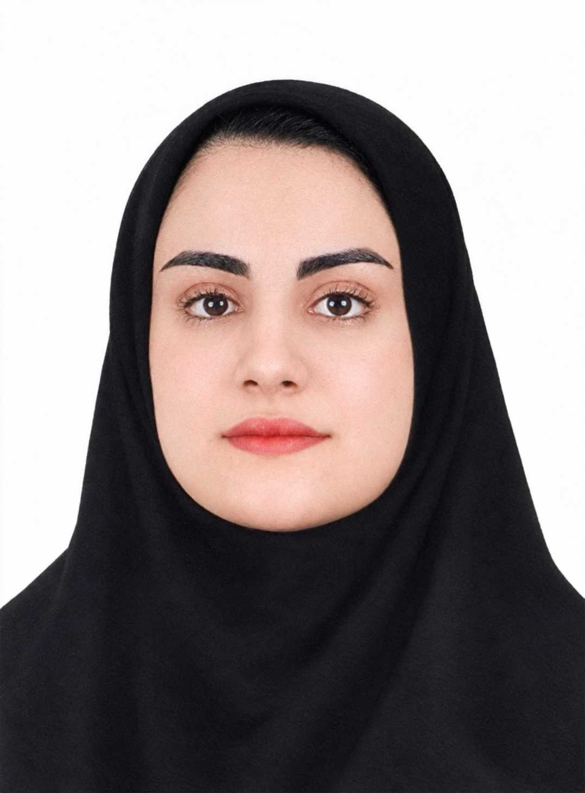

{: width="140" style="border-radius:50%"}

# نام و نام خانوادگی

دانشجوی رشته ... در دانشگاه ...

به ... و ... علاقه دارم. اینجا پروژه‌های درسی، چیزهایی که یاد می‌گیرم و راه‌های ارتباط با من را می‌بینید. در حال حاضر روی ... کار می‌کنم.

---

## مهارت‌ها و ابزارها

- Python
- Git و GitHub
- LaTeX
- HTML و CSS
- تحلیل داده

---

## پروژه‌ها

### [عنوان پروژه اول](https://github.com/username/project1)

یک یا دو جمله: پروژه چه کاری انجام می‌دهد و چه ابزارهایی در آن استفاده شده است.

*درس ... | ۱۴۰۴*

### [عنوان پروژه دوم](https://github.com/username/project2)

توضیح کوتاه درباره مسئله‌ای که حل کرده‌اید و نتیجه‌ای که گرفتید.

*پروژه شخصی*

---

## یادداشت‌ها

### ساخت اولین صفحه شخصی با GitHub Pages

امروز یاد گرفتم یک repository با نام `username.github.io` چطور به یک سایت واقعی تبدیل می‌شود. سخت‌ترین بخش، پیدا کردن نام درست repository بود.

*آبان ۱۴۰۵*

---

## ارتباط با من

- [GitHub](https://github.com/username)
- [LinkedIn](https://www.linkedin.com/in/username)
- [ایمیل](mailto:you@example.com)

